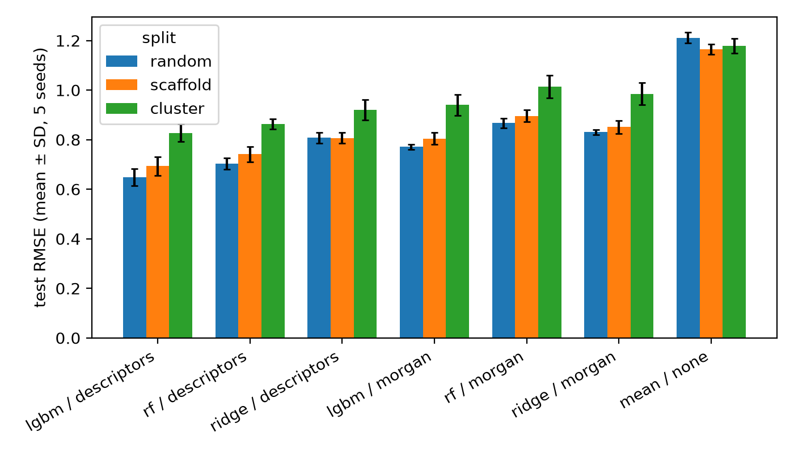
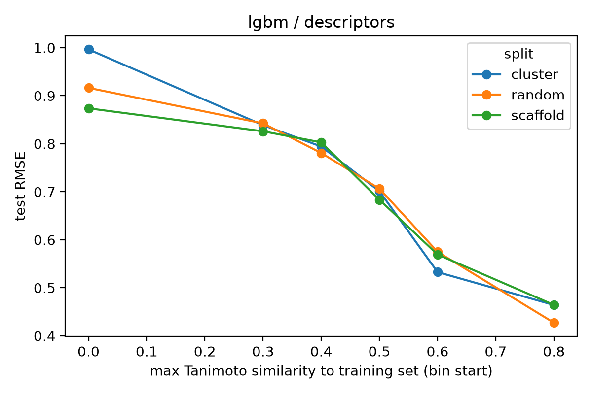
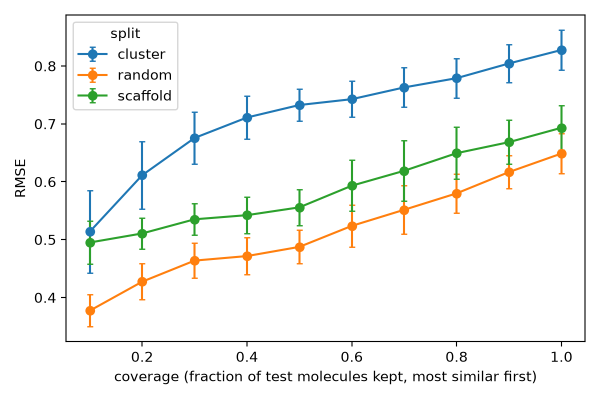
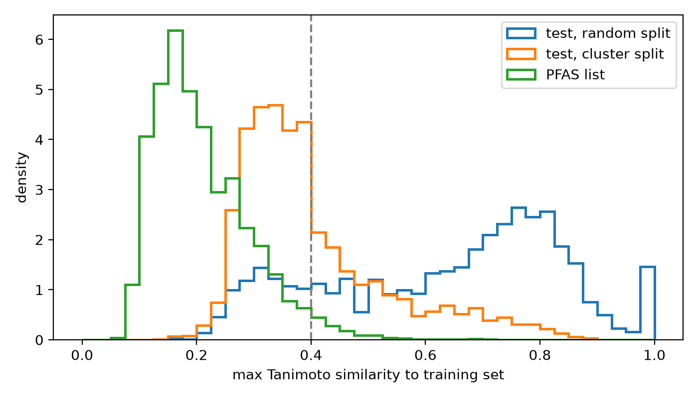

# QSAR with applicability domain, stress-tested on PFAS
A reproducible QSAR pipeline to predict lipophilicity (logD at pH 7.4) developed to explore how far a standard property model can be trusted. The pipeline consists of RDKit curation of ChEMBL data, benchmarking under random, scaffold and cluster splits, applicability-domain (AD) analysis, and conformal uncertainty. PFAS, which are almost absent from drug-like training data, are used as the stress test.

No PFAS logD measurements are used, so the PFAS results describe **coverage and uncertainty behaviour, not accuracy**.

## Contents
1. [Key findings](#key-findings)
2. [Repository layout](#repository-layout)
3. [Setup and reproduction](#setup-and-reproduction)
4. [Data](#data)
5. [Data splits](#data-splits)
6. [Baseline benchmark](#baseline-benchmark)
7. [Applicability-domain analysis](#applicability-domain-analysis)
8. [PFAS coverage](#pfas-coverage)
9. [Uncertainty quantification](#uncertainty-quantification)
10. [Limitations](#limitations)
11. [Sources, licences and citation](#sources-licences-and-citation)

## Key findings
- **Data:** 4,200 ChEMBL logD7.4 records from a single AstraZeneca document were curated to 4,190 compounds (0.24% removed).
- **Realistic splits are harder.** The best model (LightGBM / RDKit descriptors) has test RMSE 0.65 (random), 0.69 (scaffold) and 0.83 (cluster), with R² falling from 0.71 to 0.64 to 0.50. The median maximum Tanimoto similarity of test molecules to the training set falls from 0.68 to 0.56 to 0.37.
- **Similarity predicts error.** For LightGBM / descriptors, RMSE is about 0.9 to 1.0 for test molecules with max similarity below 0.3, and about 0.43 to 0.46 at 0.8 or above. The AD flag is a modest signal: test RMSE outside versus inside the AD is 1.2 to 1.6 times higher, against 1.06 to 1.19 for a mean-only baseline.
- **90% conformal intervals cover 90% on average, but not evenly.** Marginal coverage is 0.87 to 0.92, yet random forest coverage is 0.80 to 0.83 for the least similar test molecules and 0.94 to 0.98 for the most similar.
- **PFAS sit far outside the training domain.** The median max similarity of 19,391 EPA PFAS structures to the training set is 0.19 (cluster-split test molecules: 0.37). About 3% have similarity of at least 0.4, and about 13% fall inside the kNN domain. 86% have at least one RDKit descriptor outside the training range, compared with 3% to 4% of test molecules. No training compound has four or more fully fluorinated carbons.
- **Uncertainty estimates respond only partly to PFAS.** Constant-width intervals cannot change for PFAS. Random forest tree spread rises for PFAS (88% exceed the 90th percentile of test spread with descriptors, 52% with fingerprints), but no coverage guarantee applies to them.

## Repository layout
```
qsar-applicability-domain-pfas/
├── README.md
├── environment.yml            # conda environment
├── 01_curation.py             # build and curate the dataset
├── 02_train_benchmark.py      # splits, features, models, benchmark
├── 03_domain_analysis.py      # applicability domain and PFAS coverage
├── 04_uncertainty.py          # conformal intervals and PFAS uncertainty
├── src/qsar_ad/               # io, curation, splits, features, models, evaluate, domain, uncertainty, plotting
├── notebooks/                 # data exploration (target variable, PFAS subsets, descriptor range)
├── data/
│   ├── raw/                   # ChEMBL exports, PFAS list
│   └── processed/             # curated table, cached descriptors
├── results/
│   ├── tables/                # metrics, predictions, AD and conformal tables
│   └── figures/
└── docs/curation_log.md

```

## Setup and reproduction
```bash
conda env create -f environment.yml
conda activate qsar-ad
pip install -e .

python curation.py             # writes data/processed/lipo_curated.parquet and docs/curation_log.md
python 02_train_benchmark.py   # about 6 minutes (105 fits), writes results/tables/ & data/processed/rdkit_descriptors.parquet
python 03_domain_analysis.py 
python 04_uncertainty.py
```

All splits and models use fixed seeds (0 to 4).

## Data

### Source
The dataset was collected to reproduce the AstraZeneca lipophilicity set used in MoleculeNet (Lipophilicity), taken directly from ChEMBL.

- **Document:** CHEMBL3301361, "Experimental in vitro DMPK and physicochemical data on a set of publicly disclosed compounds" (Wenlock and Tomkinson; source: AstraZeneca DMPK/physicochemical; DOI 10.6019/CHEMBL3301361). The document contains 15 assays (pKa, LogD7.4, solubility, plasma protein binding, clearance), of which only the LogD7.4 assay is used.
- **Assay:** CHEMBL3301363, 4,200 measurements.
- **Endpoint:** experimental octanol/water distribution coefficient at pH 7.4 (logD7.4, unitless). 

### Extraction
| File | Level | Query / filter | Extracted | Rows |
|---|---|---|---|---|
| `CHEMBL_30_10_2026.csv` | Compounds | `_metadata.related_documents.all_chembl_ids:CHEMBL3301361` | 2026-10-30 | 5,794 |
| `CHEMBL_01_11_2026.csv` | Activities | `document_chembl_id:CHEMBL3301361` + `standard_type:logD7.4` | 2026-11-01 | 4,200 |

The compound file covers every compound in the document (all 15 assays), so it has more structures than there are LogD7.4 measurements. The activity file is used as the base of the merge, and all 4,200 rows matched a structure.

### What was used
Only the measured value (`Standard Value`, type `LogD7.4`) and the structure (SMILES) were used. ChEMBL-calculated properties in the exports (AlogP, polar surface area, QED and similar) were **not** used as features or targets.

### Curation
Curation removed 10 of 4,200 records (0.24%), leaving **4,190** compounds. The steps are documented in [`docs/curation_log.md`](docs/curation_log.md):

| Step | Records removed |
|---|---|
| Non-small-molecule entries | 5 |
| Non-numeric values / structure parsing failures | 0 |
| Duplicate structures merged (median value taken) | 5 |
| Conflicting repeats (SD > 0.5 log units) | 0 |

Structures are standardized with RDKit (cleanup, largest fragment, neutralization) and duplicates are identified by standardized InChIKey.

### Data limitations

- All data come from one assay on drug-like compounds, so the chemical space is narrow. 
- 901 of 4,190 curated compounds (21.5%) contain fluorine, and 307 (7.3%) match an OECD-style definition of PFAS (at least one fully fluorinated CF3 or CF2 carbon). Of these 290 have one such carbon, 17 have two or three, none has four or more and none is a perfluoroalkyl chain (examples are aryl-CF3, a trifluoroethyl carbamate and a tetrafluorocyclobutane). The training data therefore contain "PFAS by definition" but no long-chain PFAS chemistry.
- Structures are standardized to neutral forms before featurization, while the measurement reflects the pH 7.4 state.
- The raw files cannot be reproduced exactly from the queries alone, because the ChEMBL web interface changes between releases. Use the files in `data/raw/` for exact reproduction.

## Data splits
Models are evaluated under three splitting strategies of increasing difficulty. In each, the 4,190 curated compounds are divided into train (70%), calibration (10%, used for conformal prediction) and test (20%) sets. Whole groups are assigned to one set only, and no group is shared between sets.

| Strategy | Grouping | Groups | Largest group | Singletons |
|---|---|---|---|---|
| Random | Each molecule is its own group | 4,190 | 1 | 4,190 |
| Scaffold | Bemis-Murcko scaffold | 2,437 | 76 | 1,898 |
| Cluster | Butina clustering, Tanimoto distance cutoff 0.6 (Morgan radius 2, 2048 bits) | 1,261 | 71 | 778 |

### How difficult is each split?

For each test molecule, I computed the highest Tanimoto similarity to any training molecule (Morgan fingerprints, radius 2, 2048 bits). Values are means over 5 seeds.

| Split | Train / cal / test | Median max similarity (test to train) | Test molecules with max similarity < 0.4 |
|---|---|---|---|
| Random | 2,933 / 419 / 838 | 0.68 | 19% |
| Scaffold | 2,927 / 420 / 841 | 0.56 | 26% |
| Cluster | 2,928 / 421 / 840 | 0.37 | 65% |

Similarity to the training set falls steadily from random to scaffold to cluster splits, so the three strategies uses progressively more novel chemistry in the test set. In the cluster split, ~2/3 of test molecules have no training neighbour above 0.4 Tanimoto similarity, compared with about one fifth under a random split.

### Notes

- Even the random split has 19% of test molecules below 0.4 similarity, because the dataset is structurally diverse (4,190 drug-like compounds, many without close analogues).
- Scaffold groups are uneven (the largest has 76 molecules) and are held out whole, so actual set sizes deviate slightly from the 70/10/20 target.
- The cluster split is the closest proxy for PFAS, which sit far from drug-like training chemistry (see [PFAS coverage](#pfas-coverage)).
- Calibration sets use the same grouping as the test set, so conformal intervals are calibrated under the same level of novelty as the test.

## Baseline benchmark

Two feature sets (Morgan fingerprints, radius 2 / 2048 bits; RDKit 2D descriptors) and three models (ridge, random forest, LightGBM) were trained on the training set of each split, plus a training-mean baseline. Preprocessing is fitted on the training set only: non-finite values are set to missing and values are clipped to the float32 range, missing values are median-imputed, and zero-variance columns are dropped. For ridge, descriptors are additionally robust-scaled and clipped to [-5, 5]. Hyperparameters are fixed across splits (ridge selects alpha by leave-one-out CV within the training set). Test-set results are mean ± SD over 5 seeds (105 fits; full tables in `results/tables/`).

| Model / features | Random RMSE (R²) | Scaffold RMSE (R²) | Cluster RMSE (R²) |
|---|---|---|---|
| Mean baseline | 1.211 ± 0.022 (-0.00) | 1.164 ± 0.020 (-0.01) | 1.178 ± 0.029 (-0.01) |
| Ridge / Morgan | 0.831 ± 0.010 (0.53) | 0.852 ± 0.026 (0.46) | 0.985 ± 0.044 (0.29) |
| Random forest / Morgan | 0.867 ± 0.019 (0.49) | 0.896 ± 0.024 (0.40) | 1.014 ± 0.046 (0.25) |
| LightGBM / Morgan | 0.771 ± 0.010 (0.59) | 0.805 ± 0.023 (0.52) | 0.940 ± 0.043 (0.36) |
| Ridge / descriptors | 0.808 ± 0.022 (0.55) | 0.806 ± 0.022 (0.52) | 0.921 ± 0.041 (0.38) |
| Random forest / descriptors | 0.703 ± 0.023 (0.66) | 0.741 ± 0.031 (0.59) | 0.864 ± 0.020 (0.46) |
| **LightGBM / descriptors** | **0.649 ± 0.035 (0.71)** | **0.693 ± 0.038 (0.64)** | **0.828 ± 0.035 (0.50)** |



*Figure 1. Test RMSE (mean ± SD over 5 seeds) & R² for each model and feature set under random, scaffold and cluster splits.*

### Findings

- **Every model beats the mean baseline on every split.** The baseline RMSE (about 1.2) is roughly the standard deviation of logD7.4 in this set.
- **Performance drops as splits get harder.** For the best model (LightGBM / descriptors), RMSE rises from 0.65 (random) to 0.69 (scaffold) and 0.83 (cluster), and R² falls from 0.71 to 0.50. The Morgan models lose more R² (LightGBM: 0.59 to 0.36). Most of the drop comes from the cluster split, consistent with the similarity analysis.
- **Descriptor models beat fingerprint models on every split and all three model types**. This is likely since logD depends on bulk properties such as polarity and ionizable groups.
- **Gradient boosting was the best model for both feature sets.**
- **A linear model with descriptors is competitive.** Ridge / descriptors (0.81 on random and scaffold) is close to LightGBM / Morgan (0.77 and 0.80) and better than random forest / Morgan on every split.
- Seed SDs are 0.01 to 0.05 RMSE, so performance of the models across replicas are mostly very consistent.

**Note:** Results come from one dataset, one assay and fixed hyperparameters, so they are baselines rather than optimized models.

### Ridge on descriptors: instability and fix

In the first run, ridge on RDKit descriptors gave extreme errors on harder splits (RMSE 1.65 random, 3.56 scaffold, 39.4 cluster; R² down to -2971), while ridge on Morgan fingerprints and the tree models were unaffected. This was caused by heavy-tailed descriptors: a test molecule with a value far outside the training range receives a very large scaled value, and a linear model extrapolates the value without limit, whereas trees only compare values with thresholds. This was found to be caused by the `Ipc` descriptor.

The fix was to clip scaled descriptors to [-5, 5] after robust scaling for ridge. The bounds are fixed constants, not learned from data, so no test information leaks, and they are applied identically to every split. After the fix, ridge on descriptors gives RMSE 0.81, 0.81 and 0.92 (random, scaffold, cluster), and the other 18 results were unchanged.

## Applicability-domain analysis

Similarity to the training set is again found by the Tanimoto similarity on Morgan fingerprints (radius 2, 2048 bits). Two scores are used: the maximum similarity (`max_sim`) and the mean similarity of the 5 nearest training molecules (`knn_sim`). Two definitions of "outside the domain" are compared:

1. **Data-derived (kNN):** `knn_sim` below the 5th percentile of the training set's own leave-one-out kNN similarities, computed per split and seed from training data only.
2. **Fixed:** `max_sim` < 0.4.

### Error falls as similarity rises



*Figure 2. Test RMSE of LightGBM / descriptors in bins of max similarity to the training set (bin start on the x-axis; the first bin is 0 to 0.3), pooled over 5 seeds.*

For LightGBM / descriptors, RMSE falls from about 0.9 to 1.0 in the lowest similarity bin to about 0.43 to 0.46 for molecules with max similarity of 0.8 or more. Above 0.3 similarity the three split types lie almost on the same curve. This indicates that the error depends mainly on how similar a test molecule is to the training set, not on how the split was made. The lower performance of models trained on the harder splits are therefore largely because they put more test molecules in the low-similarity bins. In the lowest bin (below 0.3) the curves differ (cluster about 1.0, random about 0.92, scaffold about 0.87). This bin is wide, so one possible reason is that cluster-split molecules in it are further from the training set, but this was not tested. 

Spearman correlation between max similarity and absolute error is negative for every model and split (about -0.3 for tree models on random splits, -0.13 to -0.24 on cluster). The mean-baseline reference is -0.04 to -0.09, and ridge on descriptors is close to it on the cluster split, so for that model the AD adds little.

### Keeping only the most similar molecules lowers error



*Figure 3. RMSE of LightGBM / descriptors when only the most similar fraction of test molecules is kept (mean ± SD over 5 seeds).*

RMSE decreases as the kept fraction falls on all three splits. On the cluster split it goes from about 0.83 (all test molecules) to about 0.73 (most similar 50%) and about 0.51 (most similar 10%). The corresponding values are about 0.65, 0.49 and 0.38 for the random split. The curves are close to parallel, with the cluster split about 0.15 to 0.3 higher.

### Inside versus outside the domain

LightGBM / descriptors, test RMSE, pooled over 5 seeds:

| Split | Definition | Outside | RMSE inside | RMSE outside | Ratio |
|---|---|---|---|---|---|
| Random | kNN 5th percentile | 5.8% | 0.620 | 0.994 | 1.60 |
| Random | max sim < 0.4 | 18.9% | 0.585 | 0.869 | 1.49 |
| Scaffold | kNN 5th percentile | 6.6% | 0.675 | 0.907 | 1.34 |
| Scaffold | max sim < 0.4 | 26.4% | 0.632 | 0.840 | 1.33 |
| Cluster | kNN 5th percentile | 14.2% | 0.801 | 0.971 | 1.21 |
| Cluster | max sim < 0.4 | 64.7% | 0.693 | 0.890 | 1.28 |

For the mean baseline the ratio is only 1.06 to 1.19 across all rows, so part of any gap reflects the targets, not model failure. The models' ratios are clearly larger, so the excess is real, but it is modest.

- The fixed 0.4 threshold separates error slightly better than the kNN percentile on the cluster split (ratio 1.28 versus 1.21), and the two flag very different fractions of molecules there (65% versus 14%). The choice of AD definition matters, and neither is a precise per-molecule reliability measure.
- Inside the domain, error still rises from random (0.59) to cluster (0.69) under the fixed threshold, so "inside" does not mean "equally easy" on harder splits.
- The outside group under the kNN definition is small (roughly 50 to 120 molecules per seed). Results are pooled over seeds and have no confidence intervals.

### Limitations of this analysis

- Similarity is measured in Morgan space for all models, including the descriptor models.
- An AD flag indicates higher average error, not whether a given prediction is right.

## PFAS coverage

PFAS structures come from the EPA CompTox PFASSTRUCT list (downloaded 2026-11-12 from https://comptox.epa.gov/dashboard/chemical-lists/PFASSTRUCT). 21,029 entries were standardized like the training data (cleanup, neutralization), with one difference: for multi-component entries, the fragment with the most fluorine atoms is kept instead of the largest fragment. An earlier version used the largest-fragment rule and left 123 entries with no fluorine, apparently because the fluorinated component was not always the largest; this was corrected. 39 entries failed standardization, and 19,391 unique structures remained after deduplication (salt and charge forms collapse onto the same structure). Each was compared with the 4,190 curated training compounds using Morgan-fingerprint Tanimoto similarity. No logD labels are available for PFAS, so this analysis measures coverage, not accuracy.



*Figure 4. Distribution of max similarity to the training set for the PFAS list and for random- and cluster-split test molecules.*

| Set | Median max similarity | Max similarity ≥ 0.4 | Inside kNN domain |
|---|---|---|---|
| PFAS list (19,391) | 0.19 | 3.2% | 12.7% |
| Test, random split | 0.68 ± 0.01 | 81% | 94% |
| Test, scaffold split | 0.56 ± 0.02 | 74% | 93% |
| Test, cluster split | 0.37 ± 0.01 | 35% | 86% |

The ± values are the SD over 5 seeds of the per-seed median. The percentages for test sets are pooled over all test molecules and seeds.

By number of fully fluorinated carbons (OECD-style SMARTS, my approximation):

| CF carbons | n | Median max similarity | ≥ 0.4 | Inside kNN domain |
|---|---|---|---|---|
| 0 | 1,554 | 0.15 | 0.3% | 2.2% |
| 1 | 3,387 | 0.20 | 1.5% | 9.9% |
| 2-3 | 6,712 | 0.23 | 6.0% | 23.0% |
| 4+ | 7,738 | 0.18 | 1.8% | 7.0% |

- Even the cluster-split test molecules, the hardest split, are much closer to the training set than PFAS are. The training set contains 307 compounds that match the PFAS-like pattern, but nearly all are single aryl-CF3 groups, and none has four or more fully fluorinated carbons.
- Similarity is not monotonic in the number of fluorinated carbons. The 4+ group is farther from the domain than the 2-3 group, but the 0-carbon group is the farthest.
- 1,554 entries (8.0%) have no carbon matching my CF2/CF3 pattern. They are mostly fluoroarenes (about 47%), small partially fluorinated compounds with CHF2, CH2F or fluoroalkene groups (about 35%), and CF2Cl or CF2Br fragments, which my strict definition excludes but the EPA list contains. They are also small (median 12 heavy atoms against 21 for the rest of the list, and 27 for the training set), so part of their low similarity reflects size, not fluorine chemistry. At matched size, their median similarity is still lower than that of entries with a CF2/CF3 carbon, by 0.01 to 0.07.

**Sensitivity to molecular size.** The list contains molecules from 44 to 3,322 Da, whereas the training set spans 113 to 1,066 Da (1st to 99th percentile: 151 to 621 Da). Restricting the list to the training mass range leaves 15,730 structures, roughly four fifths of the list, with median max similarity 0.19 and 3.6% at 0.4 or above, compared with 0.19 and 3.2% for the full list (cluster-split test set: 0.37 and 35%). Comparing within heavy-atom bins, PFAS are below cluster-split test molecules in all bins. The coverage conclusion therefore does not depend on the very large molecules in the list.

**Descriptor space.** 86% of PFAS have at least one RDKit descriptor outside the range seen in a split's training set (81% against the full training set), compared with 2.6% (random), 3.5% (scaffold) and 4.2% (cluster) of test molecules. The most frequently out-of-range descriptors (full training range) are MinEStateIndex (51%), VSA_EState5 (50%), BCUT2D_CHGHI (41%), BalabanJ (37%) and halogen-related counts such as fr_alkyl_halide and fr_halogen (36%). A molecule counts as outside if any one descriptor is, so this shows that PFAS differ from the training set, not by how much. 17 PFAS have an `Ipc` value beyond the float32 range (training maximum about 5 × 10^15) and were clipped, and 273 PFAS (1.4%) have at least one missing descriptor, which is median-imputed and makes them look more typical than they are.

**Caveats.** PFAS were compared with the full training set while test molecules were compared with a 70% subset, which makes PFAS look slightly closer than a like-for-like comparison would. Charged forms were neutralized, whereas measured logD refers to pH 7.4. The error-versus-similarity analysis was done on drug-like test molecules. It shows that error rises at low similarity, but it does not give the error on PFAS.

## Uncertainty quantification

### Method

Prediction intervals were built with split conformal prediction. For each model, split type and seed, the model is fitted on the training set, absolute residuals are computed on the calibration set (about 420 molecules, held out with the same grouping as the test set), and the finite-sample-corrected quantile of those residuals sets the interval half-width. Two variants were used:

- **Constant width:** prediction ± q, with q the 90th percentile (or 80th) of calibration residuals. Applied to all models.
- **Normalized:** prediction ± q × (tree spread + ε), where q is the quantile of residual / (tree spread + ε) on the calibration set. Random forests only, because they provide a spread across trees.

Coverage is the fraction of test molecules whose measured logD7.4 falls inside the interval. Results are mean ± SD over 5 seeds.

### Marginal coverage

Coverage of the 90% intervals is close to the target for nearly all of the 27 model, feature and split combinations (0.87 to 0.92). Selected results:

| Model / features | Split | Coverage | Interval width (logD units) |
|---|---|---|---|
| LightGBM / descriptors | Random | 0.903 ± 0.017 | 2.10 ± 0.11 |
| | Scaffold | 0.904 ± 0.013 | 2.28 ± 0.09 |
| | Cluster | 0.874 ± 0.039 | 2.56 ± 0.34 |
| Random forest / descriptors | Random | 0.905 ± 0.023 | 2.35 ± 0.19 |
| | Scaffold | 0.906 ± 0.009 | 2.45 ± 0.06 |
| | Cluster | 0.884 ± 0.036 | 2.78 ± 0.27 |
| Mean baseline | Random | 0.903 ± 0.012 | 3.90 ± 0.12 |
| | Scaffold | 0.905 ± 0.023 | 3.76 ± 0.21 |
| | Cluster | 0.913 ± 0.025 | 3.97 ± 0.32 |

Widths are full interval widths: 2.1 means ± 1.05 logD units. The 80% intervals were also computed (`results/tables/conformal_summary.csv`).

- **The intervals are wide.** For LightGBM / descriptors a 90% interval spans about 2.1 to 2.6 logD units, consistent with its test RMSE (1.645 × 0.65 ≈ 1.07 on the random split). They are 36% to 46% narrower than those of the mean-only baseline, which shows how much the model adds.
- **Intervals widen on harder splits** (LightGBM / descriptors: 2.10, 2.28 and 2.56 for random, scaffold and cluster). This works because the calibration set is held out in the same way as the test set, so it contains equally novel molecules. Intervals calibrated on familiar chemistry and applied to novel chemistry would not widen.
- **The descriptor models on the cluster split fall slightly short** (0.874 to 0.884). With 5 seeds, the standard error of each mean is about 0.02, so the shortfall is not conclusive, and these three results share the same splits. Splitting by group does not make calibration and test molecules exactly exchangeable, which may contribute, but this was not tested.

### Coverage depends on similarity to the training set

The 90% figure is an average over groups that differ greatly in how similar they are to the training set. Coverage by maximum Tanimoto similarity to the training set (random forest / descriptors, constant-width intervals, pooled over 5 seeds; `n` values are molecule-seed pairs):

| Max similarity | Cluster | Random | Scaffold | n (cluster / random / scaffold) |
|---|---|---|---|---|
| < 0.3 | 0.80 | 0.80 | 0.83 | 840 / 296 / 385 |
| 0.3 to 0.4 | 0.88 | 0.82 | 0.87 | 1,879 / 498 / 725 |
| 0.4 to 0.5 | 0.91 | 0.83 | 0.86 | 680 / 402 / 560 |
| 0.5 to 0.6 | 0.94 | 0.87 | 0.90 | 353 / 423 / 665 |
| 0.6 to 0.8 | 0.98 | 0.94 | 0.95 | 404 / 1,621 / 1,500 |
| 0.8 to 1.0 | 0.98* | 0.97 | 0.97 | 46 / 950 / 374 |

\*Fewer than 50 pairs; not interpretable.

Molecules similar to the training set are over-covered (0.94 to 0.98), and the least similar are under-covered (0.80 to 0.83). On the random split the gap between the highest and lowest bins is about 17 percentage points. The difference is too large to be sampling noise, although the pairs are not independent (the same molecules recur across seeds), so a simple binomial interval would understate the uncertainty.

The three split types give similar coverage within each similarity bin, so coverage seems to follow similarity to the training set, not the splitting strategy. The lower marginal coverage on the cluster split is consistent with more of its test molecules (65%) falling into the low-similarity bins. This explanation fits the data but was not tested directly.

Normalizing intervals by tree spread raised coverage in the lowest bin by about 4 to 5 points (to 0.84 to 0.87) and moved the highest bins closer to 0.90, but did not reach 0.90 for the least similar molecules.

### Does tree spread track error?

For random forests, the Spearman correlation between tree spread and absolute error is positive in every case:

| Split | Descriptors | Morgan |
|---|---|---|
| Random | 0.35 ± 0.04 | 0.37 ± 0.02 |
| Scaffold | 0.27 ± 0.03 | 0.26 ± 0.03 |
| Cluster | 0.25 ± 0.04 | 0.17 ± 0.06 |

These correlations are larger in magnitude than the corresponding correlations between similarity and error (for example -0.28 for random / descriptors), but they are weak to moderate: spread identifies molecules with somewhat larger errors on average, not individual unreliable predictions. This is consistent with normalizing narrowing the intervals only modestly (2% to 9% at similar coverage, for example 2.15 versus 2.35 on random / descriptors), a difference about the size of the seed-to-seed variation.

### Behaviour on PFAS

Random forests were fitted on the training set of the cluster split (3 seeds), calibrated on its calibration set, and applied to the 19,391 standardized PFAS structures. No PFAS measurements are available, so this shows how the uncertainty estimates respond to PFAS inputs, not whether they are correct.

| Features | Median tree spread: test | Median tree spread: PFAS | PFAS above test 90th percentile of spread | Median normalized width: test | Median normalized width: PFAS |
|---|---|---|---|---|---|
| Descriptors | 0.91 | 1.22 | 88% | 2.65 | 3.45 |
| Morgan | 1.07 | 1.28 | 52% | 3.39 | 4.04 |

- **Constant-width intervals do not change.** They are 2.73 (descriptors) and 3.65 (Morgan) logD units wide for both test molecules and PFAS, because the width comes from the calibration set.
- **The descriptor forest registers PFAS as unusual; the fingerprint forest does so much less.** 88% of PFAS exceed the 90th percentile of test spread with descriptors, against 52% with fingerprints (10% expected without a shift). Normalized intervals are about 31% (descriptors) and 19% (Morgan) wider for PFAS at the median.
- **The widened intervals still claim useful skill.** The descriptor model's median PFAS interval (3.45) is narrower than the mean-only baseline's (about 3.9 to 4.0 on the cluster split).
- **The spread response is probably understated for descriptors**, because extreme descriptor values were clipped to the float32 range and missing values were imputed with training medians (see [PFAS coverage](#pfas-coverage)).
- **Coverage for PFAS is not established.** The median PFAS similarity to the training set is 0.19, within the lowest similarity bin above, where nominal 90% intervals covered 80% to 87% of drug-like test molecules. The 90% level should not be assumed for PFAS.

### Summary

1. Average coverage matches the 90% target on all three splits, with LightGBM / descriptors intervals about ±1.0 to ±1.3 logD units wide.
2. Coverage is uneven: it falls from 0.94 to 0.98 for molecules similar to the training set to 0.80 to 0.83 for the least similar.
3. Tree spread is a weak to moderate error signal, and normalizing by it gives only small gains.
4. For PFAS, constant-width intervals cannot respond to novelty, tree spread responds strongly for descriptors and weakly for fingerprints, and no coverage guarantee applies.

## Limitations

- One dataset, one assay (logD7.4) and fixed hyperparameters: the models are baselines, not optimized predictors.
- No PFAS labels are used, so PFAS accuracy and interval coverage on PFAS cannot be measured. Conformal guarantees hold for molecules exchangeable with the calibration set, which PFAS are not.
- Similarity and AD flags are computed in Morgan-fingerprint space for all models, including those using descriptors.
- The OECD-style PFAS pattern is my SMARTS approximation, and the EPA list uses its own structure-based definition.
- Structures are neutralized before featurization, whereas logD at pH 7.4 reflects the ionization state. This matters most for PFAS acids.
- The PFAS uncertainty analysis uses random forests only, one split type (cluster) and 3 seeds.
- Several statements about mechanisms (for example why cluster-split coverage is lower, or why ridge failed on descriptors) are hypotheses that were not tested directly.

## Sources, licences and citation

- **ChEMBL:** Wenlock M, Tomkinson N. Experimental in vitro DMPK and physicochemical data on a set of publicly disclosed compounds. ChEMBL document CHEMBL3301361, DOI 10.6019/CHEMBL3301361. ChEMBL data are distributed under a Creative Commons Attribution-ShareAlike licence (CC BY-SA 3.0 at the time of writing; check the current terms).
- **PFAS structures:** EPA CompTox Chemicals Dashboard, list PFASSTRUCT, downloaded 2026-11-12. 
- **Code:** MIT licence (see `LICENSE`).
