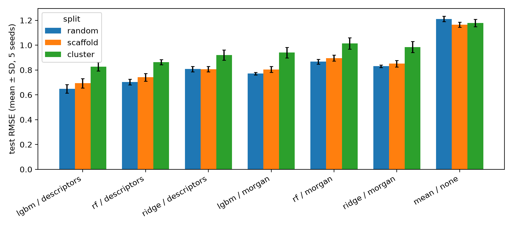
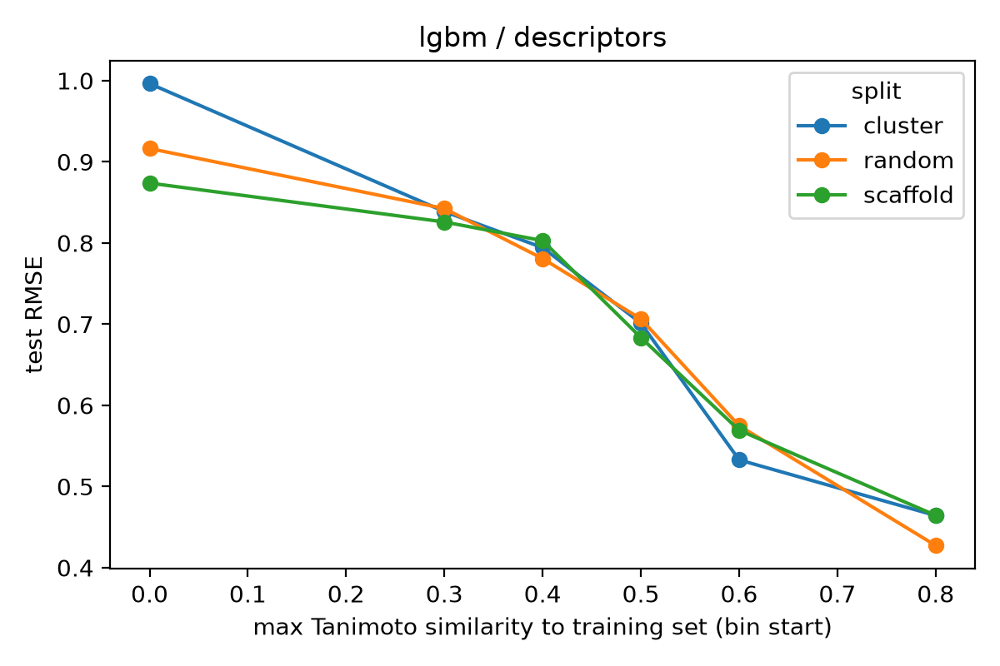
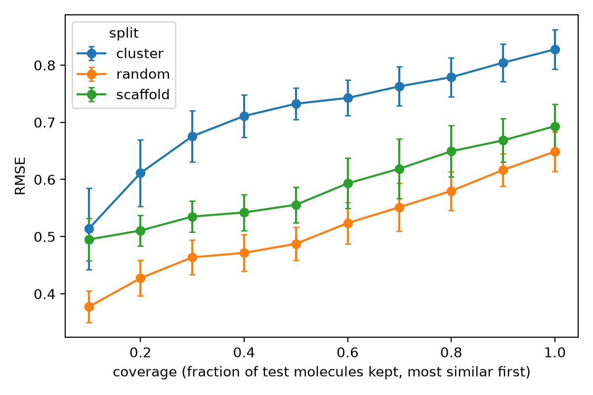
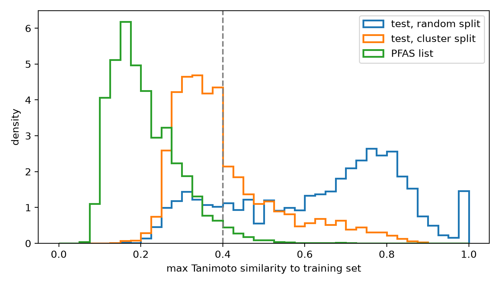

# qsar-applicability-domain-pfas
Reproducible QSAR pipeline for lipophilicity prediction: RDKit curation, benchmarking under random/scaffold/cluster splits, applicability domain analysis, and conformal uncertainty, stress-tested on PFAS chemical space.

### Source
The dataset reproduces the AstraZeneca lipophilicity set used in MoleculeNet (Lipophilicity), taken directly from ChEMBL rather than the MoleculeNet copy.

- **Document:** CHEMBL3301361, "Experimental in vitro DMPK and physicochemical data on a set of publicly disclosed compounds" (Wenlock and Tomkinson; source: AstraZeneca DMPK/physicochemical; DOI 10.6019/CHEMBL3301361). The document contains 15 assays (pKa, LogD7.4, solubility, plasma protein binding, clearance), of which only the LogD7.4 assay is used here.
- **Assay:** CHEMBL3301363, 4,200 measurements.
- **Endpoint:** Experimental octanol/water distribution coefficient at pH 7.4 (logD7.4, unitless). This is logD, not logP, so ionizable compounds are measured at their pH 7.4 ionization state.

### Extraction
| File | Level | Query / filter | Extracted | Rows |
|---|---|---|---|---|
| `CHEMBL_30_10_2026.csv` | Compounds | `_metadata.related_documents.all_chembl_ids:CHEMBL3301361` | 2026-10-30 | 5,794 |
| `CHEMBL_01_11_2026.csv` | Activities | `document_chembl_id:CHEMBL3301361` + `standard_type:logD7.4` | 2026-11-01 | 4,200 |

The compound file covers every compound in the document (all 15 assays), so it has more structures than there are LogD7.4 measurements. The activity file is the base of the merge; all 4,200 rows matched a structure.

### What was used
Only the measured value (`Standard Value`, type `LogD7.4`) and the structure (SMILES) were used. ChEMBL-calculated properties in the exports (AlogP, polar surface area, QED and similar) were **not** used as features or targets, to avoid circularity.

### Curation
Curation removed 10 of 4,200 records (0.24%), leaving **4,190** compounds.
The steps are documented in [`docs/curation_log.md`](docs/curation_log.md):

| Step | Records removed |
|---|---|
| Non-small-molecule entries | 5 |
| Non-numeric values / structure parsing failures | 0 |
| Duplicate structures merged (median value taken) | 5 |
| Conflicting repeats (SD > 0.5 log units) | 0 |

### Limitations
- All data come from one assay on drug-like compounds, so the chemical space is narrow. 901 of 4,190 curated compounds (21.5%) contain fluorine, and 307 (7.3%) match an OECD-style definition of PFAS (at least one fully  fluorinated CF3 or CF2 carbon). Almost all of these are single CF3 groups: 290 have one such carbon, 17 have two or three, and none has four or more. In the 10 structures I inspected, none is a perfluoroalkyl chain (examples are aryl-CF3, a trifluoroethyl carbamate and a tetrafluorocyclobutane). The training data therefore contain "PFAS by definition" but no long-chain PFAS chemistry.
- Structures are standardized to neutral forms (largest fragment, uncharged) before featurization, while the measurement reflects the pH 7.4 state.
- The raw files can't be reproduced exactly from the queries alone, because the ChEMBL web interface changes between releases. Use the files in `data/raw/` for exact reproduction.

## Data splits

Models are evaluated under three splitting strategies of increasing difficulty. In each, the 4,190 curated compounds are divided into train (70%), calibration (10%, used for conformal prediction) and test (20%) sets. Whole groups are assigned to one set only, and the code asserts that no group is shared between sets.

| Strategy | Grouping | Groups | Largest group | Singletons |
|---|---|---|---|---|
| Random | Each molecule is its own group | 4,190 | 1 | 4,190 |
| Scaffold | Bemis-Murcko scaffold | 2437 | 76 | 1,898 |
| Cluster | Butina clustering, Tanimoto distance cutoff 0.6 (Morgan radius 2, 2048 bits) | 1261 | 71 | 778 |

### How difficult is each split?

For each test molecule, I computed the highest Tanimoto similarity to any training molecule (Morgan fingerprints, radius 2, 2048 bits) across 5 seeds. The following values are the mean across all 5 seeds

| Split | Train / cal / test | Median max similarity (test to train) | Test molecules with max similarity < 0.4 |
|---|---|---|---|
| Random | 2,933 / 419 / 838 | 0.68 | 19% |
| Scaffold | 2,927 / 420 / 841 | 0.56 | 26% |
| Cluster | 2,928 / 421 / 840 | 0.37 | 65% |

Similarity to the training set falls steadily from random to scaffold to cluster splits, so the three strategies probe progressively more novel chemistry. Under the cluster split, two thirds of test molecules have no training neighbour above 0.4 Tanimoto similarity, compared with about one fifth under a random split.

### Notes
- Even the random split has 19% of test molecules below 0.4 similarity, because the dataset is structurally diverse (4,190 drug-like compounds,  many without close analogues).
- Scaffold groups are uneven: acyclic molecules share one empty scaffold and are held out together, so the actual set sizes deviate slightly from the 70/10/20 target.
- The cluster split is the closest proxy for PFAS, which are expected to sit far from drug-like training chemistry (this is tested in the applicability domain analysis).
- Splits are repeated over 5 random seeds (0-4) to give error bars.
- Calibration sets use the same grouping as the test set, so conformal intervals are calibrated under the same level of novelty as the test.
- Scalers and any tuning use the training set only.

## Baseline benchmark

Two feature sets (Morgan fingerprints, radius 2 / 2048 bits; RDKit 2D descriptors, cleaned using training-set statistics only) and three models (ridge, random forest, LightGBM) were trained on the training set of each split, plus a training mean baseline. Hyperparameters are fixed and identical across splits (ridge selects its alpha by leave-one-out CV within the training set), so differences between splits reflect the split, not retuning. Test-set results below are mean ± SD over 5 seeds (105 fits; full tables in `results/tables/`).

| Model / features | Random RMSE (R²) | Scaffold RMSE (R²) | Cluster RMSE (R²) |
|---|---|---|---|
| Mean baseline | 1.211 ± 0.022 (-0.00) | 1.164 ± 0.020 (-0.01) | 1.178 ± 0.029 (-0.01) |
| Ridge / Morgan | 0.831 ± 0.010 (0.53) | 0.852 ± 0.026 (0.46) | 0.985 ± 0.044 (0.29) |
| Random forest / Morgan | 0.867 ± 0.019 (0.49) | 0.896 ± 0.024 (0.40) | 1.014 ± 0.046 (0.25) |
| LightGBM / Morgan | 0.771 ± 0.010 (0.59) | 0.805 ± 0.023 (0.52) | 0.940 ± 0.043 (0.36) |
| Random forest / descriptors | 0.703 ± 0.023 (0.66) | 0.741 ± 0.031 (0.59) | 0.864 ± 0.020 (0.46) |
| **LightGBM / descriptors** | **0.649 ± 0.035 (0.71)** | **0.693 ± 0.038 (0.64)** | **0.828 ± 0.035 (0.50)** |
| Ridge / descriptors | 0.808 ± 0.022 (0.55) | 0.806 ± 0.022 (0.52) | 0.921 ± 0.041 (0.38) | | |

*Figure 1. Test RMSE (mean ± SD over 5 seeds) for each model and feature set under random, scaffold and cluster splits.*

### Findings
- **Every model beats the mean baseline on every split**, whose RMSE (about 1.2) is roughly the standard deviation of logD7.4 in this set.
- **Performance drops as splits get harder.** For the best model (LightGBM / descriptors), RMSE rises from 0.65 (random) to 0.69 (scaffold) and 0.83 (cluster), and R² falls from 0.71 to 0.50. The Morgan models lose more R² (LightGBM: 0.59 to 0.36). Most of the drop comes from the cluster split, consistent with the similarity analysis: random-to-scaffold is a small step, scaffold-to-cluster a large one.
- **Descriptor models beat fingerprint models on every split**, and the advantage holds on the cluster split, where fingerprints have fewer similar training molecules to rely on. This is plausible for logD, which depends on bulk properties such as polarity and ionisable groups.
- **Gradient boosting was the best model for both feature sets.**
- Seed SDs are 0.01 to 0.05 RMSE, so gaps between neighbouring models on the same split (for example LightGBM vs random forest on descriptors) are within seed noise unless compared seed by seed.

### Caveats
- Test sets contain different molecules under each split, so RMSE across splits is not strictly like-for-like. It shows how the same pipeline fares as test molecules become more novel.
- Ridge on descriptors was numerically unstable (extreme predictions for a few test molecules) due to very heavy-tailed descriptors, this was fixed by introducing clippings of descriptors for more robust scaling
- Results come from one dataset, one assay and fixed hyperparameters, so they are baselines rather than optimised models.

## Applicability-domain analysis

Similarity to the training set is the Tanimoto similarity on Morgan fingerprints (radius 2, 2048 bits). Two scores are used: the maximum similarity (`max_sim`) and the mean similarity of the 5 nearest training molecules (`knn_sim`). Two definitions of "outside the domain" are compared:

1. **Data-derived (kNN):** `knn_sim` below the 5th percentile of the training set's own leave-one-out kNN similarities, computed per split and seed from training data only.
2. **Fixed:** `max_sim` < 0.4.

### Error falls as similarity rises

*Figure 2. Test RMSE of LightGBM / descriptors in bins of max similarity to the training set (bin start on the x-axis; the first bin is 0 to 0.3), pooled over 5 seeds.*

For LightGBM / descriptors, RMSE falls from about 0.9 to 1.0 in the lowest similarity bin to about 0.43 to 0.46 for molecules with max similarity of 0.8 or more. Above 0.3 similarity the three split types lie almost on the same curve. This is consistent with error depending mainly on how similar a test molecule is to the training set, not on how the split was made. The harder splits would then be harder largely because they put more test molecules in the low-similarity bins. The lowest bins have few molecules, <50, so differences there (cluster about 1.0,scaffold about 0.87) may be noise.

Spearman correlation between max similarity and absolute error is negative for every model and split (about -0.3 for tree models on random splits, -0.13 to -0.24 on cluster). The mean-baseline reference is -0.04 to -0.09, and ridge on descriptors is close to it on the cluster split, so for that model the AD adds little.

### Keeping only the most similar molecules lowers error

*Figure 3. RMSE of LightGBM / descriptors when only the most similar fraction of test molecules is kept (mean ± SD over 5 seeds).*

RMSE decreases as coverage falls on all three splits. On the cluster split it goes from about 0.83 (all test molecules) to about 0.73 (most similar 50%) and about 0.51 (most similar 10%). The corresponding values are about 0.65, 0.49 and 0.38 for the random split. The curves are close to parallel, with the cluster split about 0.15 to 0.3 higher.

### Inside versus outside the domain (LightGBM / descriptors, test RMSE)

| Split | Definition | Outside | RMSE inside | RMSE outside | Ratio |
|---|---|---|---|---|---|
| Random | kNN 5th percentile | 5.8% | 0.620 | 0.994 | 1.60 |
| Random | max sim < 0.4 | 18.9% | 0.585 | 0.869 | 1.49 |
| Scaffold | kNN 5th percentile | 6.6% | 0.675 | 0.907 | 1.34 |
| Scaffold | max sim < 0.4 | 26.4% | 0.632 | 0.840 | 1.33 |
| Cluster | kNN 5th percentile | 14.2% | 0.801 | 0.971 | 1.21 |
| Cluster | max sim < 0.4 | 64.7% | 0.693 | 0.890 | 1.28 |

For the mean baseline the ratio is only 1.06 to 1.17 across all rows, so part of any gap reflects the targets, not model failure. The models' ratios are clearly larger, so the excess is real, but it is modest.

- The fixed 0.4 threshold separates error slightly better than the kNN percentile on the cluster split (ratio 1.28 vs 1.21), and the two flag very different fractions of molecules there (65% vs 14%). The choice of AD  definition matters, and neither is a precise per-molecule reliability measure.
- Inside the domain, error still rises from random (0.59) to cluster (0.69), so "inside" does not mean "equally easy" on harder splits.
- Outside groups are small in the kNN definition (roughly 50 to 120 molecules per seed). Results are pooled over seeds and have no confidence intervals.

### Limitations of this analysis
- Similarity is measured in Morgan space for all models, including the descriptor models.
- An AD flag indicates higher average error, not whether a given prediction is right.

## PFAS coverage

PFAS structures come from the EPA CompTox PFASSTRUCT list (downloaded on 2026-11-12 from https://comptox.epa.gov/dashboard/chemical-lists/PFASSTRUCT). 21,029 entries were standardized
with the same pipeline as the training data (largest fragment, neutralization): 39 failed, and 19,391 unique structures remained after deduplication (salt and charge forms collapse onto the same structure). Each was compared with the 4,190 curated training compounds using Morgan-fingerprint Tanimoto similarity. No logD labels are available for PFAS, so this analysis
measures coverage, not accuracy.

| Set | Median max similarity | Max similarity ≥ 0.4 | Inside kNN domain |
|---|---|---|---|
| PFAS list (19,530) | 0.19 | 3.2% | 12.7% |
| Test, random split | 0.68 ± 0.01 | 81% | 94% |
| Test, scaffold split | 0.56 ± 0.02 | 74% | 93% |
| Test, cluster split | 0.37 ± 0.01 | 35% | 86% |

By number of fully fluorinated carbons (OECD-style SMARTS, my approximation):

| CF carbons | n | Median max similarity | ≥ 0.4 | Inside kNN domain |
|---|---|---|---|---|
| 0 | 1,554 | 0.16 | 0.3% | 2.2% |
| 1 | 3,387 | 0.20 | 1.5% | 9.9% |
| 2–3 | 6,707 | 0.23 | 6.0% | 23.0% |
| 4+ | 7,735 | 0.18 | 1.8% | 7.0% |

- Even the cluster-split test molecules, the hardest split, are much closer to the training set than PFAS are. The training set contains 307 compounds that match the PFAS-like pattern, but nearly all are single aryl-CF3 groups, and none has four or more fully fluorinated carbons.
- Similarity is not monotonic in the number of fluorinated carbons. The 4+ group is farther from the domain than the 2–3 group, but the 0-carbon group is the farthest. 
- 1,554 entries (8.5%) have no carbon that matches my OECD-style CF2/CF3 pattern. They are mostly fluoroarenes (47%), small partially fluorinated compounds with CHF2, CH2F or fluoroalkene groups (about 35%), and CF2Cl or CF2Br fragments, which the strict definition excludes but the EPA list contains. They are also small (median 12 heavy atoms against 21 for the rest of the list, and 27 for the training set), so part of their low similarity reflects size, not fluorine chemistry. At matched size, their median similarity is still lower than that of entries with a CF2/CF3 carbon, by 0.01 to 0.07.
- The error-versus-similarity analysis was done on drug-like test molecules. It shows that error rises at low similarity, but it does not tell us the error on PFAS.

**Caveats.** PFAS were compared with the full training set while test molecules were compared with a 70% subset, which favours PFAS slightly. Charged forms were neutralized, whereas measured logD refers to pH 7.4. The list includes large molecules (up to about 3,600 Da) that are far from drug-like chemistry for reasons other than fluorine.

The PFAS list contains molecules from [x] to [y] Da, whereas the training set spans 113-1066 Da (1st-99th percentile: 151-621). Restricting the list to the training mass range leaves 15730 structures (80.5%) and gives a median max similarity of 0.19 and 3.6% with similarity ≥ 0.4, compared with 0.19 and 3.2% for the full list
(0.37 and 65% for the cluster-split test set). Comparing within heavy-atom bins, PFAS are below cluster-split test molecules in all bins.